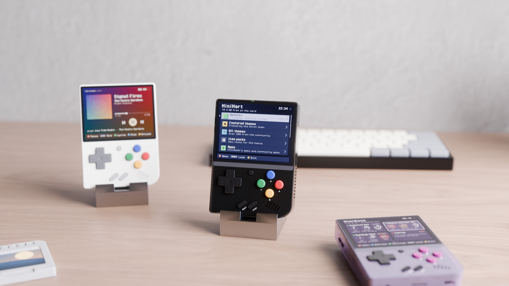
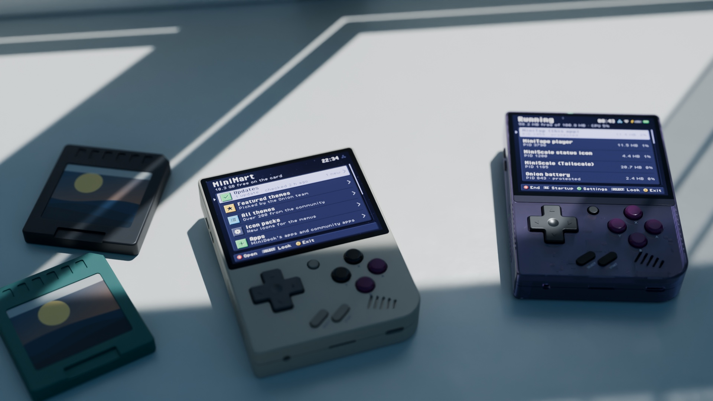

<p align="center"></p>

[](https://github.com/zakijss/MiniMart/actions/workflows/ci.yml)
[](https://github.com/zakijss/MiniMart/releases)
[](LICENSE)

# MiniMart

Themes, icon packs, apps and homebrew games for a Miyoo Mini Plus. Apps and ports are checked against a pinned SHA-256 before they are installed, and games are too when their repository gives one. Part of [MiniDeck](https://github.com/zakijss/MiniDeck).

- Themes and icon packs from [OnionUI/Themes](https://github.com/OnionUI/Themes), and the [Silky Remix SUPER GAME BOY++](https://github.com/zakijss/SuperGameBoy) theme and its icon pack.
- Every MiniDeck app, and the community apps that install as an Onion app folder, each pinned to a release.
- Homebrew games from [Homebrew Hub](https://hh3.gbdev.io) whose licence allows downloading.
- Your own repositories and catalogues alongside the built-in ones.
- Lists sorted by name, newest, size or (apps) category, and an app's README on its page.
- **START** on Apps and Ports downloads the lists again, and **L2**/**R2** jump to the top or bottom of any list. A list that can't be downloaded offers to try again.


<p align="center"></p>

## Using it

Community apps are made by other people and aren't reviewed: the checksum proves you got the file that was listed, nothing more. Instead of ratings, each app's page lists facts you can check against its repository: licence, release, size, whether it updates itself, what it changes outside its folder, and what it signs in to. Read the repository before you install. Updates keep each app's settings.

The community list is rebuilt every day by `tools/catalog`, which finds Onion apps on GitHub, pins each release, and derives the facts from the app's own files and README; `tools/catalog/exclude.json` lists what it leaves out and why. When the list can't be downloaded, MiniMart shows the copy built into it.

**Ports** lists the [MiyooMini-Ports](https://github.com/Producdevity/MiyooMini-Ports) list. A port whose release is laid out for Onion's Ports list installs from here: `tools/catalog` pins its zip and SHA-256 every day (`ports.json` on the `catalog` release), and MiniMart unpacks only what goes in `Roms/PORTS`. Removing a port deletes the files MiniMart installed and keeps the ones you added. The rest of the list is a guide to where each port comes from; `tools/catalog/ports-exclude.json` names the ones left out and why.

A port of a commercial game is only the engine. MiniMart never downloads game data: you copy the files from your own copy of the game into `Roms/PORTS/Games/<game>/`, and the game shows up in Onion's Ports list as soon as the file it needs is there (MiniMart runs the same check Onion does). Community apps that need a single file from a game work the same way: MiniMart looks on the card for a copy that matches a known-good dump, then in your own game files folder if you set one in Repositories, and otherwise lets you pick the file.

**Updates**, at the top of the home screen, checks the repositories for newer versions of everything MiniMart installed and updates one item or all of them, each download checked against its pinned SHA-256. Themes, icon packs and homebrew games have no versions, so they aren't checked. Pages that install something show the free space on the card and how much the install needs.

## Install

- **Updates:** MiniMart updates itself, from **Apps > MiniMart**.
- **Zip:** download `minimart-VERSION.zip` from [Releases](https://github.com/zakijss/MiniMart/releases/latest), unzip it onto the root of the SD card, and restart.
- **Every MiniDeck app at once:** [minideck-all.zip](https://github.com/zakijss/MiniDeck/releases/latest/download/minideck-all.zip).

## Requirements

A Miyoo Mini Plus on Onion OS 4.4, with Wi-Fi. Other devices and firmwares aren't supported.

## Building

```sh
make check                     # vet, tests, scripts
make package VERSION=1.0.0     # dist/: the release zip, app.json, SHA256SUMS
make deploy HOST=root@miyoo    # build and copy to a device over SSH
make catalog                   # rebuild the community list and cmd/minimart/picks.go
```

Go runs in Docker unless you pass `GO=go` (Go 1.27). The interface, themes and networking come from the [MiniDeck library](https://github.com/zakijss/MiniDeck); see its [development notes](https://github.com/zakijss/MiniDeck/blob/main/docs/DEVELOPMENT.md) and [contributing guide](https://github.com/zakijss/MiniDeck/blob/main/CONTRIBUTING.md).

## License

[MIT](LICENSE). Third-party components are listed in [NOTICE](NOTICE). Not made by or affiliated with Miyoo.
