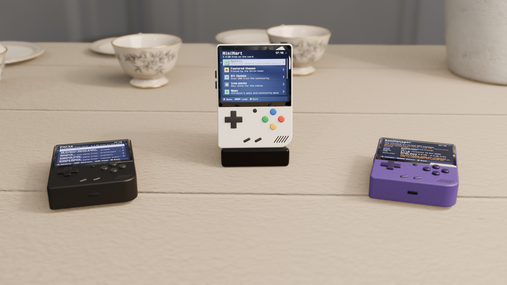
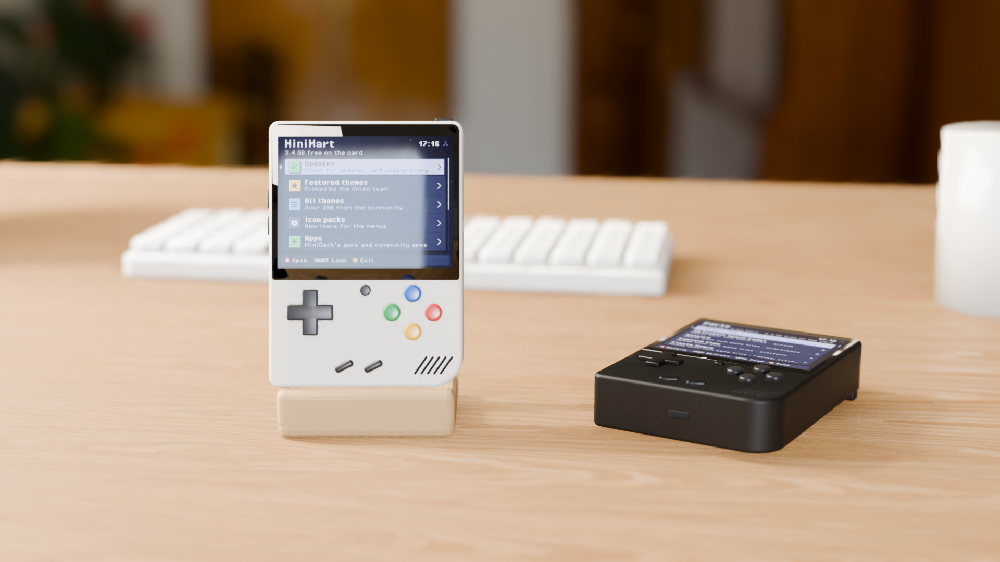

<p align="center"></p>

[](https://github.com/zakijss/MiniMart/actions/workflows/ci.yml)
[](https://github.com/zakijss/MiniMart/releases)
[](LICENSE)

# MiniMart

Themes, icon packs, apps, ports and homebrew games for a Miyoo Mini Plus. Apps and ports are checked against a pinned SHA-256 before they are installed, and games are too when their repository gives one. Part of [MiniDeck](https://github.com/zakijss/MiniDeck).

- Themes and icon packs from [OnionUI/Themes](https://github.com/OnionUI/Themes), and the [Silky Remix SUPER GAME BOY++](https://github.com/zakijss/SuperGameBoy) theme and its icon pack.
- Every MiniDeck app, and the community apps that install as an Onion app folder, each pinned to a release.
- Ports from the [MiyooMini-Ports](https://github.com/Producdevity/MiyooMini-Ports) list, with the owner's own games, [Endless Sky](https://github.com/zakijss/EndlessSky) and [Armiger](https://github.com/zakijss/Armiger), at the top and signed.
- Homebrew games from [Homebrew Hub](https://hh3.gbdev.io) whose licence allows downloading.
- **Updates** for everything it installed, with what changed in each version.
- Your own repositories and catalogues alongside the built-in ones.

<p align="center"></p>

## Install

MiniMart updates itself, from **Apps > MiniMart**. To install it, unzip `minimart-VERSION.zip` from [Releases](https://github.com/zakijss/MiniMart/releases/latest) onto the root of the SD card and restart. Every MiniDeck app comes in one zip too: [minideck-all.zip](https://github.com/zakijss/MiniDeck/releases/latest/download/minideck-all.zip).

Needs a Miyoo Mini Plus on Onion OS 4.4, with Wi-Fi. Other devices and firmwares aren't supported.

## Using it

Lists sort by name, newest, size or (apps) category. An app's page shows its README and how much room it takes on the card once installed; pages that install something show the free space and what the install needs. **START** on Apps and Ports downloads the lists again, and **L2**/**R2** jump to the top or bottom of any list.

**Updates**, at the top of the home screen, checks for newer versions of everything MiniMart installed. **A** shows what changed since the installed version (from the release's `CHANGELOG.md`) and updates it; **Y** updates all of them. An app's new files are all written beside the installed ones before any is replaced, so a full card or a bad zip leaves the installed app as it was. Updates keep each app's settings. Themes, icon packs and homebrew games have no versions, so they aren't checked.

### Community apps

Community apps are made by other people and aren't reviewed: the checksum proves you got the file that was listed, nothing more. Instead of ratings, each app's page lists facts you can check against its repository: licence, release, size, whether it updates itself, what it changes outside its folder, and what it signs in to. Read the repository before you install.

### Ports

A port installs from MiniMart when its release is laid out for Onion's Ports list; MiniMart unpacks only what goes in `Roms/PORTS`. A port's page shows its picture at the top. Removing a port deletes the files MiniMart installed and keeps the ones you added.

Endless Sky and Armiger are signed: each release zip has a [minisign](https://jedisct1.github.io/minisign/) signature beside it, and MiniMart installs or updates one only if the signature checks out with the owner's key. A missing or bad signature refuses the install and writes nothing.

A port of a commercial game is only the engine. MiniMart never downloads game data: copy the files from your own copy of the game into `Roms/PORTS/Games/<game>/`, and the game shows up in Onion's Ports list once the file it needs is there. Community apps that need a single file from a game work the same way: MiniMart looks on the card for a copy that matches a known-good dump, then in your game files folder if you set one in Repositories, and otherwise lets you pick the file.

<details>
<summary><b>How the lists are built</b></summary>

`tools/catalog` rebuilds the community apps and ports lists every day. It finds Onion apps on GitHub, pins each release, and derives each app's facts from its own files and README; for ports it pins each zip and its SHA-256 (`ports.json` on the `catalog` release). `tools/catalog/exclude.json` and `ports-exclude.json` list what it leaves out and why. When a list can't be downloaded, MiniMart offers to try again and shows the copy built into it.

</details>

## Building

```sh
make check                     # vet, tests, scripts
make package VERSION=1.0.0     # dist/: the release zip, app.json, SHA256SUMS
make deploy HOST=root@miyoo    # build and copy to a device over SSH
make catalog                   # rebuild the community list and cmd/minimart/picks.go
```

Go runs in Docker unless you pass `GO=go` (Go 1.27). The interface, themes and networking come from the [MiniDeck library](https://github.com/zakijss/MiniDeck); see its [development notes](https://github.com/zakijss/MiniDeck/blob/main/docs/DEVELOPMENT.md) and [contributing guide](https://github.com/zakijss/MiniDeck/blob/main/CONTRIBUTING.md).

## License

[MIT](LICENSE). Third-party components are listed in [NOTICE](NOTICE). Not made by or affiliated with Miyoo.
